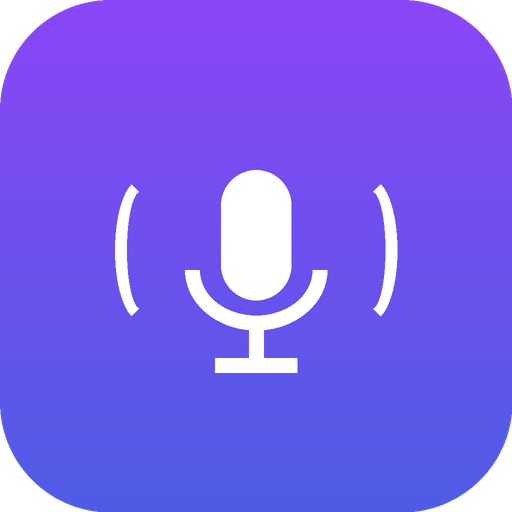

<p align="center">
  
</p>

<h1 align="center">WFlow — Voice Dictation for macOS</h1>

<p align="center">
  <b>Press F8 anywhere → speak → your words appear in the active app.</b><br>
  Ultra-low-latency cloud speech-to-text powered by Groq Whisper, with a modern native GUI.
</p>

<p align="center">
  
  
  
  
</p>

---

## ✨ What is WFlow?

WFlow is a lightweight, open-source voice dictation application for macOS inspired by [Wispr Flow](https://www.wispr.com/). It captures audio from your microphone, sends it to the **Groq Whisper Large v3 Turbo** API for blazing-fast transcription (~180–300ms), and automatically pastes the result into whichever application you're using — Slack, Chrome, VS Code, Notes, Terminal, anything.

### Key Features

| Feature | Description |
|---|---|
| 🎙️ **Global Hotkey** | Press `F8` (or `Fn + F8`) from any app on your Mac to start/stop dictation. |
| ⚡ **Ultra-Low Latency** | Groq Whisper Large v3 Turbo delivers sub-300ms cloud transcription. |
| 📋 **Seamless Auto-Paste** | Transcribed text is pasted directly into the focused app via `Cmd + V` using native Quartz events. Your clipboard is saved and restored automatically. |
| 🎨 **Modern Dark GUI** | Beautiful CustomTkinter interface with live VU meter, recording timer, and tabbed settings. |
| 📌 **Mini HUD Mode** | Collapse the app into a floating always-on-top pill widget while you work. |
| 🍏 **Native `.app` Bundle** | Double-click `WFlow.app` from Finder or pin it to your Dock — no terminal required. |
| 📜 **Transcription History** | Scrollable log of past dictations with timestamps, duration, and latency stats. |
| ⚙️ **Configurable** | Switch Whisper models, choose your mic input device, toggle auto-paste and audio chimes. |

---

## 🚀 Getting Started

### Prerequisites

- **macOS 11 (Big Sur) or later** (tested up to macOS 15 Sequoia)
- **Python 3.10+**
- A **Groq API key** — get one free at [console.groq.com](https://console.groq.com/)
- **[`uv`](https://github.com/astral-sh/uv)** (recommended, for zero-config dependency management) or `pip`

### Installation

```bash
# Clone the repository
git clone https://github.com/<your-username>/WFlow.git
cd WFlow

# Set up your API key
cp .env.example .env
# Edit .env and paste your Groq API key

# Create a virtual environment and install dependencies
uv venv && uv pip install -r requirements.txt

# Build the native macOS app bundle
bash build_app.sh
```

### Running

**Option 1 — Native App (Recommended)**
Double-click **`WFlow.app`** in the project folder, or drag it into your Applications folder / Dock.

**Option 2 — Shell Launcher**
```bash
./run.sh
```

**Option 3 — CLI Mode (Legacy, no GUI)**
```bash
./run.sh --cli
```

---

## ⚙️ The Graphical Interface

The GUI is organized into three tabs:

### Dictation Tab
- **Hero Record Button**: Click or press `F8` to toggle recording. Visual states: `● Ready` → `🔴 Recording...` → `⏳ Transcribing...`.
- **Live Audio VU Meter**: Real-time volume bar reflecting your voice level.
- **Recording Duration Counter**: Shows elapsed time during recording.
- **Transcription Result**: Displays the full text with latency and duration metrics.
- **One-Click Copy**: Copy the latest transcription to clipboard.

### History Tab
- Scrollable list of past transcriptions with timestamps, latency, and audio duration.
- Clear history with one click.

### Settings Tab
- **Groq API Key**: Enter/update your key (persisted to `.env` and `settings.json`).
- **Model Selection**: Switch between `whisper-large-v3-turbo` (fastest) and `whisper-large-v3` (most accurate).
- **Microphone Input**: Select from detected audio input devices (MacBook mic, AirPods, USB headset, etc.).
- **Toggles**: Auto-paste on/off, audio chimes on/off, always-on-top window.

### Mini HUD Mode
Click **📌 Mini HUD** to collapse the app into an ultra-compact floating widget that stays on top of all windows while you work.

---

## 🔑 macOS Permissions

On first launch, macOS will prompt for two permissions:

1. **Microphone**: Required to capture audio. Click **Allow** when prompted.
2. **Accessibility**: Required to simulate the `Cmd + V` keystroke into the active application. Go to **System Settings → Privacy & Security → Accessibility** and check WFlow (or the Python binary).

> [!NOTE]
> If you run via Terminal or WezTerm, the terminal app itself may also need Accessibility permission.

---

## 🏗️ Architecture

```
┌─────────────────────────────────────────────────────────┐
│                    WFlow Application                     │
│                                                          │
│  ┌──────────────┐   ┌──────────────┐   ┌──────────────┐ │
│  │  Global       │   │  Audio       │   │  Groq        │ │
│  │  Hotkey (F8)  │──▶│  Capture     │──▶│  Whisper API │ │
│  │  (pynput)     │   │  (sounddevice│   │  (REST)      │ │
│  └──────────────┘   │   16kHz mono) │   └──────┬───────┘ │
│                      └──────────────┘          │         │
│                                                 ▼         │
│  ┌──────────────┐   ┌──────────────────────────────────┐ │
│  │  Clipboard   │◀──│  Transcription Result             │ │
│  │  Save/Paste/ │   │  → Display in GUI                 │ │
│  │  Restore     │   │  → Auto-paste into active app     │ │
│  │  (Quartz)    │   │  → Save to history                │ │
│  └──────────────┘   └──────────────────────────────────┘ │
│                                                          │
│  ┌──────────────────────────────────────────────────────┐│
│  │  CustomTkinter GUI  │  Thread-safe event queue       ││
│  │  VU meter, tabs, settings, Mini HUD                  ││
│  └──────────────────────────────────────────────────────┘│
└─────────────────────────────────────────────────────────┘
```

---

## 📂 Project Structure

| File | Description |
|---|---|
| [`app_gui.py`](app_gui.py) | Main GUI application with VoiceEngine, CustomTkinter interface, and event queue |
| [`flow.py`](flow.py) | Original CLI-only dictation prototype (terminal mode) |
| [`build_app.sh`](build_app.sh) | Builds `WFlow.app` macOS bundle with compiled Mach-O launcher and icon |
| [`run.sh`](run.sh) | Shell launcher supporting `--cli` flag for terminal mode |
| [`test_paste.py`](test_paste.py) | Standalone test for the clipboard save → paste → restore cycle |
| [`requirements.txt`](requirements.txt) | Python dependencies |
| [`AppIcon.icns`](AppIcon.icns) | macOS app icon (generated via Pillow + `iconutil`) |
| `.env` | Your Groq API key (not committed — see `.env.example`) |

---

## 🤖 Built with Google Antigravity + REA

This entire project — from the initial CLI prototype to the full graphical application and native macOS `.app` bundle — was built collaboratively in a single pair-programming session using **[Google Antigravity](https://blog.google/technology/google-labs/project-mariner-gemini-model-agent/)** (AGY), Google DeepMind's agentic AI coding assistant.

### What Antigravity Did

- **Designed the architecture**: Clipboard-save → paste → restore pipeline, microphone capture with `sounddevice`, Groq Whisper API integration, and the global `F8` hotkey via `pynput`.
- **Built the GUI from scratch**: A full dark-mode CustomTkinter interface with tabbed navigation (Dictation / History / Settings), live VU audio meter, Mini HUD overlay mode, and persistent settings/history.
- **Created the native macOS app bundle**: Wrote a compiled Mach-O C launcher, `Info.plist` with microphone/accessibility usage descriptions, and an `iconutil`-built `.icns` icon.
- **Diagnosed and fixed a macOS 15 Sequoia crash**: When the app crashed on launch with `SIGILL` (`Illegal instruction: 4`), Antigravity read the crash reports from `~/Library/Logs/DiagnosticReports/`, identified the root cause as a new main-thread assertion in Carbon's `TISGetInputSourceProperty` (triggered by `pynput`'s background thread calling `keycode_context`), and wrote a targeted monkey-patch that pre-caches the keyboard layout on the main thread.
- **Fixed a CoreAudio real-time thread crash**: Identified that calling Tkinter methods from PortAudio's real-time `IOThread.client` callback caused `SIGSEGV`, and replaced all cross-thread GUI calls with a thread-safe `queue.Queue` polling pattern.

### Role of REA (Reverse Engineering Agent)

**REA** is an advanced reverse engineering MCP toolserver bundled with Antigravity. While this project didn't involve reverse engineering a binary, REA's **macOS platform expertise** was instrumental:

- **Crash report analysis**: REA's deep understanding of macOS crash report formats (`.ips` files), Mach-O binaries, and system frameworks like Quartz, CoreAudio, and Carbon helped Antigravity quickly interpret the `EXC_BAD_INSTRUCTION` and `EXC_BAD_ACCESS` crash dumps to pinpoint the faulting threads and frame stacks.
- **macOS internals knowledge**: Understanding the `_dispatch_assert_queue_fail` assertion pattern in `libdispatch`, the behavior of `CGEventTapCreate` and `kCGSessionEventTap`, and the thread-safety requirements of `TSMGetInputSourceProperty` in macOS 15 Sequoia — all informed by REA's platform analysis capabilities.
- **Native binary packaging**: Knowledge of Mach-O executable structure, `Info.plist` keys, and macOS LaunchServices behavior guided the creation of a properly structured `.app` bundle with a compiled C launcher instead of a shell script wrapper.

> [!TIP]
> REA can do much more — decompile native binaries, trace call paths, analyze Electron/JavaScript apps, instrument processes with Frida, and more. Learn more in the [Antigravity documentation](https://blog.google/technology/google-labs/project-mariner-gemini-model-agent/).

---

## 🛠️ Technical Notes

### macOS 15 Sequoia Compatibility
WFlow includes a workaround for a breaking change in macOS 15 where Apple added a strict main-thread assertion to Carbon's Text Input Source services. The `pynput` keyboard listener calls `TISGetInputSourceProperty` on a background thread, which now causes an immediate `SIGILL` crash. WFlow pre-caches the keyboard layout context on the main thread at import time and patches both `pynput._util.darwin` and `pynput.keyboard._darwin` to use the cached value.

### Thread Safety
The CoreAudio real-time audio callback runs on a dedicated `com.apple.audio.IOThread.client` thread. WFlow never calls Tkinter/Tcl methods from this thread. Instead, audio volume levels are stored in a shared float, and the main thread polls it via a 50ms `after()` timer. State changes from background threads are communicated through a thread-safe `queue.Queue`.

### Clipboard Preservation
When auto-paste is enabled, WFlow:
1. Saves the current clipboard contents via `pbpaste`
2. Copies the transcription to the clipboard via `pbcopy`
3. Simulates `Cmd + V` using native Quartz `CGEventCreateKeyboardEvent` (with AppleScript fallback)
4. Waits 200ms, then restores the original clipboard contents

This ensures the user's clipboard is never permanently altered by a dictation.

---

## 📄 License

This project is open source. See [LICENSE](LICENSE) for details.

---

<p align="center">
  <sub>Built in a single session with <b>Google Antigravity</b> and <b>REA</b> 🚀</sub>
</p>
